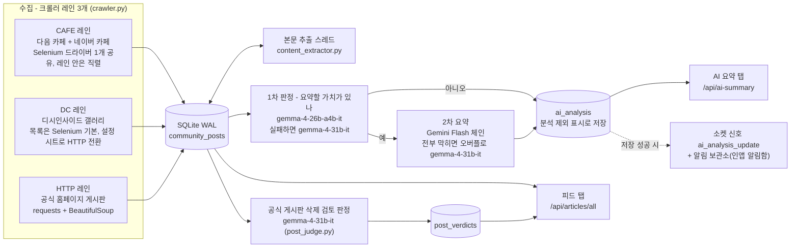

# 구조 - 수집에서 화면까지

이 스냅샷의 범위(피드 · AI 요약 흐름)만 그린다. 모델 이름·주기·상수는 v6.7.747(2026-10-26) 코드에서 확인했다. 범위 밖 기능은 같은 경로의 스텁이라 여기서 다루지 않는다.

## 흐름

- **레인** = 병렬의 단위다. Selenium 드라이버는 스레드에 안전하지 않아 "드라이버 하나 = 레인 하나" 로 묶었다. 다른 레인끼리는 병렬로 돈다(v6.7.291).
- **레인 주기**: CAFE · DC 는 모듈 기본 70~120초, HTTP 는 180~300초다. DAUM · DC 는 설정 시트 값으로 덮어쓰고, NAVER 는 덮어쓰지 않는다(v6.7.487 주석).
- **다음 카페는 2026-10-05 부터 수집하지 않는다.** 설정 시트에서 수집 대상 링크를 지웠고, 코드 경로(목록이 비면 바로 돌아온다)만 남아 있다. 마지막 글 10-05(2026-10-23 DB 실측).
- **1차가 "아니오" 인 글도 저장한다.** 요약문 자리에 `[분석 제외]` 를 남겨 다음 사이클이 같은 글을 다시 묻지 않게 한다(v6.7.64).
- **2차 체인**은 하루 한 번 모델 목록에서 살아 있는 정식 Flash 를 최신순으로 최대 5개 고른다(v6.7.600 동적 확정, v6.7.680 길이 3 -> 5). 앞 모델의 키를 다 쓰면 다음 모델로 내려간다. 남은 일일 예산은 남은 시간에 고르게 나눈다(v6.7.436). 오버플로 티어는 Flash 가 전부 막혔을 때만 돈다 - 실패 모드를 "침묵" 에서 "품질 저하" 로 내리는 장치다(v6.7.448 - 코드 주석은 `[v6.7.447]` 로 적혀 있다).
- **알림**: 실제 요약이 있는 레코드만 소켓 신호와 보관소 적재로 이어진다. 저장이 실패하면 둘 다 건너뛴다(v6.7.484). 보관소 원장(`notif_store.py`)과 알림함 화면(`notif-inbox.js`)은 넣었고, 그 사이의 조회 API 는 스텁이다.
## 스케줄 잡 (피드 · 요약 흐름만)

| id | 주기 | 하는 일 |
|---|---|---|
| `gemma4_summary_worker` | 20초 (v6.7.447) | 대기 글을 배치 10 x 병렬 4(v6.7.652)로 묶어 1차 판정, 통과분 2차 요약, 저장 뒤 알림 |
| `post_judge` | 120초 (v6.7.665) | 공식 게시판 유저 글의 삭제 검토 판정(최근 7일 v6.7.668, 배치 10) -> 피드 탭 제재 토글 |
| `main_crawler_healthcheck` | 60초 | 레인별 마지막 성공 시각으로 멈춘 레인을 찾고 재시작을 예약 |
| `content_extractor_healthcheck` | 60초 | 본문 추출 스레드 생존 확인 · 재시작 |
| `status_update_emit` | 30초 (v6.7.209) | 크롤러 상태 소켓 송출. 이것을 그리던 헤더 상태 표시는 v6.7.628 · v6.7.741 에 지웠고, 지금 이 신호를 쓰는 곳은 범위 밖 탭(부속 수집기)뿐이다 |
| `main_crawler_restart` | 일회성 | 위 헬스체크가 필요할 때만 예약하는 재시작 |

- 잡 말고 스레드로 도는 것: 크롤러 레인 3개, 본문 추출(5초 간격, 한 번에 20건 - `web_lib/bg/contents.py`, v6.7.747 기준).
- 같은 파일에 있지만 흐름 밖: `remote_kill_web_check`(2분, 원격 정지 신호 확인) · `client_status_update`(3분, 설정 시트에 이 기기 상태 기록).
- 범위 밖(스텁): 이상감지 · 동향 리포트 · 방문 기록 · 볼륨 백업 · 웹 푸시 · 헬스 샘플 · 보관 삭제 잡.
- 잡 개수는 적지 않는다. 부팅 로그가 `scheduler.get_jobs()` 로 개수와 id 목록을 직접 찍는다(v6.7.461). 스텁 상태의 목록은 `web_app/tests/bootstrap_jobs_snapshot.json`.

## 모듈 지도 (원본 그대로 옮긴 파일만)

| 묶음 | 파일 | 하는 일 |
|---|---|---|
| 진입 | `web_app/app.py` | Flask 앱 생성, 스케줄러 잡 등록, 부팅. `IMT_DISABLE_BOOTSTRAP=1` 이면 백그라운드를 띄우지 않는다 |
| 수집 | `crawlers/crawler.py` | 레인 구성과 루프, 글 정규화 · 중복 제거 · SQLite 저장 |
| | `crawlers/naver_cafe.py` · `dc_http.py` · `official_poe.py` | 네이버 카페 목록 · 디시 목록 HTTP 가져오기 · POE 공식 게시판 |
| | `crawlers/content_extractor.py` | 본문이 빈 글을 골라 본문을 채운다 |
| 저장 | `utils/sqlite_handler.py` | 연결마다 WAL, 대기 글 조회, `ai_analysis` 저장 |
| | `utils/google_sheets_handler.py` · `service_accounts.py` | 설정 시트 읽기, 429 때 계정 전환 |
| LLM | `ai_lib/gemma4_summary_core.py` | 1차 · 2차 본체 - 모델 상수, 키 배정, 재시도 · 폴백, 체인 확정, 예산 페이싱 |
| | `ai_lib/genai_client.py` | SDK 클라이언트 생성과 재시도 상한을 한 자리에 |
| | `ai_lib/prompts/gemma4_system_instruction.txt` | 2차 공통 지침의 백업 사본. 런타임에는 설정 시트의 값을 읽고 이 파일은 읽지 않는다(`prompts/README.md`) |
| 백그라운드 | `web_lib/ai_gemma4_worker.py` | 요약 사이클 - 배치 나누기, 병렬 실행, 워치독, 저장 뒤 알림 |
| | `web_lib/bg/post_judge.py` | 삭제 검토 판정 잡 |
| | `web_lib/bg/scheduler.py` · `contents.py` · `crawler_singleton.py` | 크롤러 기동 · 헬스체크 · 재시작, 크롤러 싱글톤 |
| | `web_lib/bg/broadcast.py` · `notif_store.py` | 상태 송출, 알림 보관소 원장 |
| 화면 API | `web_lib/routes/articles.py` | 피드 글 목록(5초 TTL 캐시) + 공식 글의 판정 결과 붙이기 |
| | `web_lib/routes/analysis.py` | AI 요약 목록 · 대기열 · 수동 요약 요청 · 사유 라벨 |
| | `web_lib/routes/_helpers.py` · `health.py` · `pages.py` | 등급 가드와 TTL 캐시 공장, 생존 확인, 메인 페이지 |
| 화면 | `templates/partials/tabs/feed.html` · `ai_summary.html` | 두 탭의 틀 |
| | `static/js/tabs/feed-tab.js` · `ai-summary-tab.js` · `static/js/socket.js` · `main/notif-inbox.js` | 탭 렌더, 소켓 수신, 알림함 |
| 시험 | `web_app/test_*.py` · `web_app/tests/` | 계약 스냅샷과 회귀 시험 |

## 설계 결정 셋

**1. 판정과 요약을 다른 모델에 맡긴다** (v6.7.64, 2026-05-15). 그 전에는 Gemma 4 한 번 호출로 분류와 요약을 같이 했다. 나눈 기대 효과는 두 가지였다 - 1차가 짧은 예/아니오만 내니 토큰과 추론 부담이 줄고, 요약 품질은 Flash 수준이 된다. 측정 근거는 남아 있지 않다. 그 뒤 1차 주력을 31b 에서 26b(thinking 끔)로 바꿨다(v6.7.698, 2026-09-28). 1차 재현율 표본(20건)에서 두 모델이 7/10 으로 같았고, 10건 콜이 26b 4초 · 31b 41초였다.

**2. 1차는 짧은 전용 지침을 읽는다** (v6.7.687, 2026-09-24). 1차 입력의 약 90% 가 2차용 공통 지침(13,807자)이었고, 그것이 분당 입력 토큰 한도를 먹어 429 가 상시였다. 공통 지침에서 수집 · 제외 기준만 남겨 607자로 줄였다. 콜당 프롬프트는 약 15,200자 -> 약 2,000자. 바꾸기 전에 층화 표본 두 개(140건)로 쟀고, 공통 지침은 잡는데 새 지침만 놓친 글은 0건이었다. 다만 1차 콜 소요는 줄지 않았다 - 지연은 입력이 아니라 thinking 이 만들었고, 그 축은 v6.7.697 에서 따로 풀었다.

**3. 늦어지는 원인을 재고 나서 배치를 병렬로 돌렸다** (v6.7.454, 2026-07-28 / v6.7.652, 2026-09-09). 1차 콜 소요를 T(n) = 10.70 + 3.58n 초로 모델링하니(28표본, R² 0.867) 고정비가 23% 뿐이라, 배치를 키우거나 주기를 줄여도 피크 가동률 0.98 이 안 내려갔다. 기울기를 바꾸는 수단은 병렬화뿐이었다. 1차 콜은 원격 API 대기라 스레드가 잠들어 2코어 서버에서도 CPU 를 거의 쓰지 않는다. 병렬 2 로 사이클 140초 -> 91.2초, 가동률 0.64. 이어서 사이클 상한을 `BATCH_SIZE x BATCH_PARALLEL` 에 묶고 병렬도를 4 로 올렸다 - 상한 30 · 워커 2 조합에서는 뒤 웨이브의 절반이 놀아 처리량이 천장의 75% 였다. 2차는 예산 카운터를 지키려고 직렬로 두었고, 그 구간은 사이클의 9% 였다(2026-09-09 측정).

## 등급

`anon < manager < admin` 세 단계다(`web_app/web_lib/routes/_helpers.py` `_require_role`, v6.7.248). AI 요약 탭 조회는 manager 이상, 수동 요약 요청 · 재분석 · 사유 라벨은 admin 만 된다.

## 운영 환경

운영 서버(저사양 홈 서버, 2코어, AVX 없음) 한 대에서 웹앱 · 크롤러 · 스케줄러가 한 프로세스로 돈다. 요청 처리는 1워커 x 8스레드(2026-09-07 구성)라, 무거운 계산은 요청 경로 밖(워커 스레드)에서 끝내고 결과만 캐시에 바꿔 넣는다(v6.7.437).
